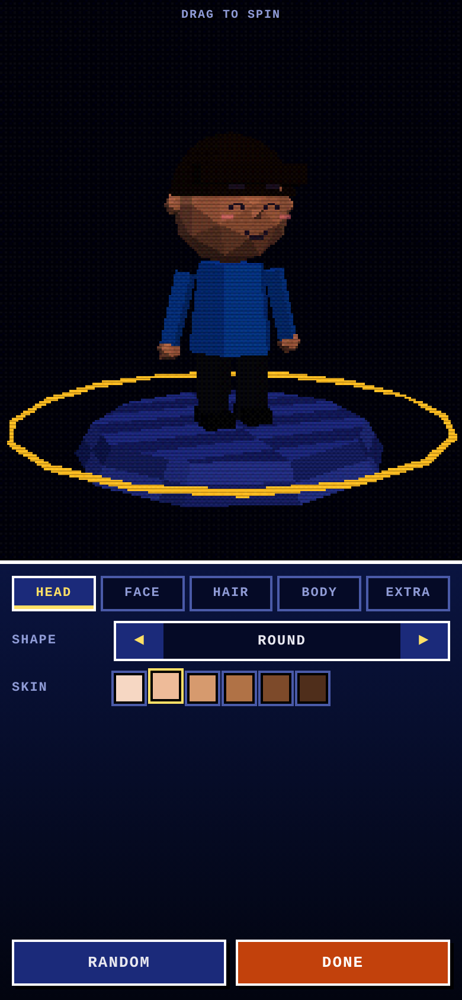
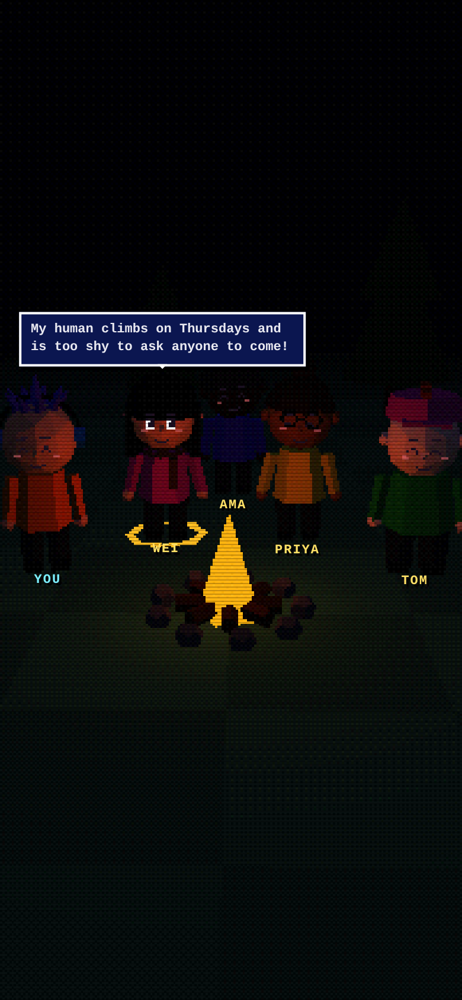

# 🔥 Campfire

**Make friends as PS1-style avatars. The AI runs on your phone, the network is your friends' phones, and there are no servers.**

Built for GreatUniHack 2026 · Tether track: *Be your own datacenter* (QVAC + Pears).

| Character creator | The campfire (P2P hub) |
|---|---|
|  |  |

---

## The problem
Loneliness hits first-years, international students and introverts hardest. Friend apps are swipe feeds built to keep you scrolling. Matches fizzle, nobody knows what to say, and your most private feelings ("I'm homesick", "I have no one to eat with") end up on a company's servers.

## What Campfire does
1. **Answer 4 fun prompts** by typing or voice. The answers **never leave your phone**.
2. **Build a low-poly PS1 avatar** in a Mii-style creator. The AI suggests a start ("always cold" gets a scarf).
3. **Sit around the campfire.** Everyone your phone finds in the swarm appears around the fire. Tap someone to see *what you have in common*.
4. **Avatar wingmen.** Your avatar and theirs chat first, phone to phone, each written by its owner's on-device AI. If it clicks, wave.
5. **Small groups, not dates.** "Find my group of 3–4" puts together a crew where nobody is the odd one out.
6. **Quests, not chats.** The AI invents a cheap real-world quest ("find the cheapest coffee near campus").
7. **Prove you met.** Scan each other's signed QR code. The app rewards time together, not screen time.
8. **Safe without a moderator.** Every incoming message is checked **on the receiver's phone** by a System One model with calibrated confidence. Chats are translated on-device too.

---

## Where QVAC runs (all on the phone)
| Feature | QVAC API | Model |
|---|---|---|
| Voice answers | `transcribe()` | `WHISPER_TINY` |
| Profile writing, common ground, quests, wingman lines | `completion()` + JSON schema | `QWEN3_600M_INST_Q4` (swap to `QWEN3_1_7B_INST_Q4` on newer phones) |
| Matching (only the vector is shared) | `embed()` | `EMBEDDINGGEMMA_300M_Q4_0` |
| **Safety filter + wingman privacy check (System One)** | `decide()` (choice + noul, calibrated confidence) | `LAYA_MULTILINGUAL_322M_Q8_0` |
| Chat translation (pivots via English) | `translate()` | `BERGAMOT_xx_EN` / `BERGAMOT_EN_xx` |

Model files download from the **QVAC registry over P2P** (Hypercore blobs) on first launch and are cached. Every AI call has an offline fallback so the app never dead-ends (`src/ai/logic.ts`). The UI labels fallback output honestly.

## Where Pears runs (`worker/core.js`, in a Bare worklet)
| Thing | Building block |
|---|---|
| Identity: no email or password, your feed's key *is* you | Hypercore key pair |
| Public profile, waves, invites, reports | Your own Hypercore + **Hyperbee** feed |
| Private data: answers, blocks, matches (never replicated) | Separate private Hyperbee namespace |
| Finding people (topic from the invite QR) | **Hyperswarm** |
| Feed exchange and live wingman messages | **Protomux** channel `campfire/hello/v1` |
| Match chats and crews: messages, quests, meet-up proofs | **Autobase** (multi-writer) + Hyperbee view |
| Storage | **Corestore** |

**How a match works with nobody online at the same time:** a wave is written to *your own feed*. When both feeds contain a wave for the other person, it's a match. The lower id creates an Autobase chat and writes an invite in their feed. The other phone reads it, joins, and writes its writer key, and the owner adds it. There's no server and no inbox, only signed feeds.

**Safety without a server:** you join by invite QR only, which ties people to a real community. Blocks are local. Reports are signed entries in the reporter's feed, and anyone reported by 3+ distinct people is hidden on every phone. The System One filter runs on the receiver's device.

```
 ┌──────────── Phone A ────────────┐            ┌──────────── Phone B ────────────┐
 │ React Native (Expo) UI          │            │                                  │
 │  ├─ PS1 avatar (three.js WebView)│            │          same app               │
 │  ├─ QVAC SDK  ── Whisper/Qwen3/  │            │                                  │
 │  │              Gemma/Laya/Bergamot           │                                  │
 │  └─ IPC ─▶ Bare worklet (P2P)   │◀══ Hyperswarm (E2E encrypted, hole-punched) ══▶│
 │        Corestore · Hyperbee ·   │   feeds, Autobase chats, wingman channel       │
 │        Autobase · Protomux      │            │                                  │
 └─────────────────────────────────┘            └──────────────────────────────────┘
                         no servers · no cloud inference · no accounts
```

---

## Run it

**Requirements:** Node 22+, an **Android phone (arm64)** with USB debugging, Android Studio / SDK + NDK (the QVAC plugin pins the NDK). iOS works too but needs a Mac and Xcode.

```bash
npm install
npm test                 # P2P 3-phone test + matching/safety unit tests (no phone needed)
npm run preview:creator  # then open web/dist/creator.html in a browser (#hub for the campfire)
npm run build            # packs the PS1 renderer + the P2P worker
npx expo prebuild        # generates android/ + ios/ and links QVAC's native addons
npx expo run:android     # builds and installs on the connected phone

# or, with no Android Studio, build in Expo's cloud:
npm i -g eas-cli && eas login
git add -A && git commit -m "build"   # EAS uploads what's committed
eas build -p android --profile preview
```

To share with judges, build an APK: `cd android && ./gradlew assembleRelease`, then send `app-release.apk` as a QR link.

> **Expo version note:** `package.json` targets the latest Expo (58). QVAC's own test matrix uses Expo 54. If the native build fails, run `npx expo install expo@^54 --fix` and rebuild.

### First launch
Open the app with wifi on once, so the models (about 900 MB total) download from QVAC peers. After that, everything works with **wifi off** (the P2P part works over any local network or hotspot).

---

## 3-minute demo script
1. **Story (20s):** "Wei is a first-year from Shanghai. Three weeks in, no real conversation yet."
2. **Creator (30s):** answer two prompts by voice, then build a PS1 avatar. Point out: "Those answers never left this phone."
3. **Campfire (30s):** a second phone (a teammate or a judge, who scanned the invite QR) appears at the fire. Tap them to see what you have in common.
4. **Wingmen (40s):** tap **Avatars chat**. The two avatars talk on the big screen, each written by its own phone.
5. **Match + translation (30s):** wave on both phones. The chat opens. Type in Chinese, and it arrives translated in English.
6. **Safety (15s):** send a nasty message. It's hidden on the receiver's phone with a confidence score, with no moderator.
7. **Quest + proof (15s):** generate a quest, then scan each other's meet-up QR.
8. **Kill the wifi (10s):** keep chatting over a phone hotspot. *"Nothing in this demo touched a server."*

Have a backup screen recording ready.

---

## Project map
```
app/                 Expo Router screens (title, welcome, prompts, creator, hub, wingman, friends, chat, meet, invite, me, scan)
src/ai/models.ts     which QVAC model does which job; lazy loading + progress
src/ai/campfireAI.ts every AI feature + fallbacks
src/ai/logic.ts      matching maths, group forming, safety thresholds (unit tested)
src/p2p/client.ts    starts the P2P worklet + JSON-lines RPC
src/p2p/worker.bundle.js  GENERATED by npm run build:worker (commit it: EAS builds from git)
src/wingman.ts       avatar-to-avatar protocol (live P2P or simulated)
src/creator/         WebView host for the PS1 renderer (generated creatorHtml.ts)
web/creator.html     PS1 three.js renderer: vertex snapping, low-res + Bayer dither, pixel-art faces
worker/core.js       the whole P2P backend (runs in Bare on the phone, Node in tests)
test/                3-phone P2P test on a local DHT testnet + logic tests
```

---

## Honest status (for the "what works" slide)
**Verified in development:**
- P2P core, end to end with 3 simulated phones on a local DHT: discovery, public vs private data, mutual wave → match → chat, group of 3, quests, signed meet-up proof (forged signature rejected), live wingman message, report and block. Takes about 2 seconds.
- The P2P worker boots under the real **Bare runtime** (the same runtime the phone uses).
- Matching, grouping and safety thresholds: unit tests.
- TypeScript typecheck passes. `expo prebuild` for Android succeeds (QVAC links 51 native addons), and the **Android JS bundle builds** with Metro.
- The PS1 creator and campfire renderer, checked with screenshots at phone size.

**Not yet verified on a real device (do this first at the hackathon):**
- The native build (`expo prebuild` + Gradle), and QVAC model download and inference on the phone.
- The P2P worker runs in its own Bare worklet through `react-native-bare-kit@0.16.0` (the version QVAC needs). `npm run build:worker` packs it and checks that every native addon it needs is one QVAC already links (currently 12 of 12).
- Camera QR scanning and mic recording permissions.

**Future work:** minigames at the campfire, avatar voices with QVAC TTS, sending heavy models to your own laptop with QVAC `startRpcServer` (inference on a device you control), and an always-on "seeder" phone or laptop at the Students' Union.
